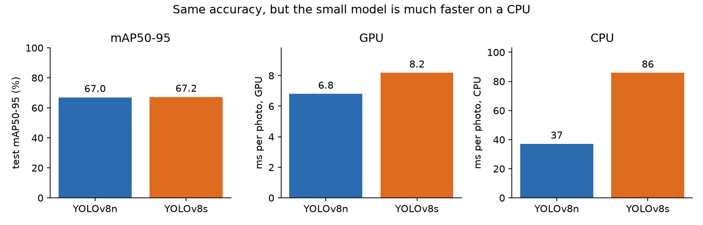
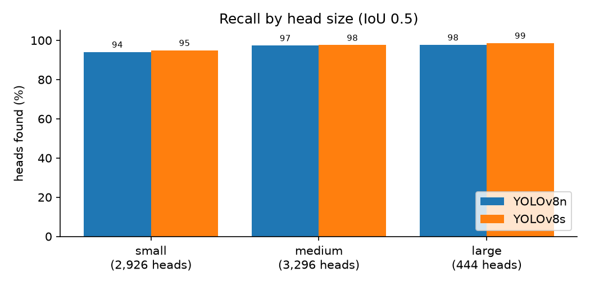

# Hard Hat Detection

[](https://github.com/Gauhet/hard-hat-detection/actions/workflows/tests.yml)

Finds construction workers' heads in photos and video and marks each one as wearing a hard hat
(green) or not (red). It fine-tunes COCO-pretrained YOLOv8 models on the public-domain Hard Hat
Workers dataset and reaches **97.3% mAP50** on the held-out test set.


<sub>Footage: U.S. Department of Labor (OSHA), public domain, via Wikimedia Commons. The model never saw it during training.</sub>

The project compares two model sizes, measures where the detector misses (small, distant heads),
and tests it as a per-photo "someone here has no hard hat" alarm, which is closer to how a site
would actually use it.

## Results

Both models were trained with the same data, settings and seed, and evaluated on 1,766 test
photos (6,666 heads) that were never used for training or model selection.

| | mAP50 | mAP50-95 | Parameters | GPU, ms/photo | CPU, ms/photo | Training |
|-|-|-|-|-|-|-|
| **YOLOv8n** | 97.3% | 67.0% | 3.1M | 6.8 | **37** | 39 min |
| **YOLOv8s** | 97.3% | 67.2% | 11.1M | 8.2 | 86 | 59 min |

<sub>Latency is the median time for the network on one photo at a time, at 640 px. GPU: RTX 4050 Laptop. CPU: Intel Core Ultra 7 155H.</sub>



**The bigger model doesn't pay off here.** YOLOv8s has 3.5× the parameters but gets the same
mAP50 and only 0.2 points more mAP50-95, while taking more than twice as long per photo on a CPU. Two
classes of fairly uniform objects don't need the extra capacity, so YOLOv8n is the better choice,
especially on a CPU or an edge device. The training curves agree: both models level off at about
the same validation mAP, and YOLOv8s stopped early at epoch 45 after 15 epochs without
improvement.


On a GPU, batch-of-one latency is dominated by fixed overheads rather than model size, so the
gap there is small. It also varied by a millisecond or two between runs; the CPU numbers are
the reliable comparison.

### Per class

| | Hard hat AP50 | Bare head AP50 | Hard hat AP50-95 | Bare head AP50-95 |
|-|-|-|-|-|
| YOLOv8n | 97.9% | 96.8% | 67.5% | 66.5% |
| YOLOv8s | 98.2% | 96.3% | 67.4% | 67.1% |

Bare heads are slightly harder. There are about a third as many of them in the training data,
and a bare head looks more like the background (hair, shadows, the back of a head) than a
brightly coloured hard hat does.

### Small heads are where it misses



Using COCO's size buckets (small is under 32×32 pixels in the original photo), the models find
97–99% of medium and large heads but 94–95% of small ones. Small heads are 44% of the test set,
because many photos are wide shots of a whole site. The mAP50-95 of 67% is much lower than the
mAP50 of 97% for the same reason: on a head 20 pixels wide, a box that is off by a few pixels
already fails the stricter overlap thresholds.

### As a safety alarm

A site doesn't need every box to be perfect. It needs to know whether anyone in view is missing a
hard hat. So each test photo is also scored as an alarm: it should go off if the photo contains
at least one bare head (339 of the 1,766 photos do).

| | Alarms raised correctly | False alarms | Missed photos | Precision | Recall |
|-|-|-|-|-|-|
| YOLOv8n | 315 | 55 | 24 | 85.1% | 92.9% |
| YOLOv8s | 320 | 50 | 19 | 86.5% | 94.4% |

<sub>Confidence threshold 0.25, the Ultralytics default.</sub>

This is the one place YOLOv8s is measurably better: it misses 5 fewer photos. For a safety
system a missed bare head costs more than a false alarm, so in practice I'd lower the threshold
for the head class and accept more false alarms.

### Sample test predictions


## How it works

**Data** ([`data.py`](src/hardhat_detector/data.py)). The dataset comes as parquet files with
COCO-style boxes (left, top, width, height in pixels). These are clipped to the image and
converted to YOLO's format (centre x, centre y, width, height as fractions of the image), and each
photo and its label file are written to disk in the folder layout Ultralytics expects. The
official 5,297-photo training split is divided 90/10 into training and validation with a fixed
seed; the 1,766-photo test split is used only for the final numbers.

The source also labels a "person" class, but only about 600 people are boxed across 7,000 photos
full of workers. Labels that incomplete would teach the model that most people are background, so
the class is dropped (along with three boxes labelled "others"), leaving `helmet` and `head`.

**Training** ([`train.py`](src/hardhat_detector/train.py)). Both models start from COCO weights,
so they already know what people look like, and are fine-tuned for up to 50 epochs at 640 px with
the Ultralytics defaults (AdamW, mosaic and colour augmentation, early stopping with a patience
of 15). The best epoch by validation mAP50-95 is kept.

**Evaluation** ([`evaluate.py`](src/hardhat_detector/evaluate.py),
[`metrics.py`](src/hardhat_detector/metrics.py)). mAP comes from Ultralytics. Recall by size and
the alarm metrics are computed separately: predictions are matched to ground-truth boxes greedily,
most confident first, each claiming the unmatched same-class box it overlaps most if the IoU is at
least 0.5. That is the same rule mAP uses, applied at a single threshold. These helpers have their
own unit tests.

**Video** ([`predict.py`](src/hardhat_detector/predict.py)). Frames are read with OpenCV, run
through the detector one at a time, drawn on, and written back out, along with a count of how many
frames showed a bare head.

## Running it

Requires Python 3.10+. Install PyTorch for your hardware first
([pytorch.org](https://pytorch.org/get-started/locally/)), then the package:

```bash
git clone https://github.com/Gauhet/hard-hat-detection.git
cd hard-hat-detection
pip install -e ".[dev]"
```

Train (the dataset, about 270 MB, downloads and converts on the first run; the COCO weights
download automatically):

```bash
python -m hardhat_detector.train --model yolov8n
python -m hardhat_detector.train --model yolov8s
```

Evaluate every trained model on the test set and regenerate the figures in `assets/`:

```bash
python -m hardhat_detector.evaluate
```

Run the detector on your own photos or videos (annotated copies go to `predictions/`):

```bash
python -m hardhat_detector.predict site.jpg clip.mp4 --model checkpoints/yolov8n.pt
```

Or try it in the browser: a Gradio app with a photo tab (upload or pull a random test photo) and
a video tab, and a choice of model and confidence threshold.

```bash
pip install -e ".[demo]"
python app.py   # then open http://localhost:7860
```

Run the tests:

```bash
pytest
```

## Project layout

```
src/hardhat_detector/
  data.py        dataset download, COCO-to-YOLO conversion, train/val split
  train.py       fine-tuning command
  metrics.py     box matching, recall by size, per-photo alarm metrics
  evaluate.py    test-set evaluation, model comparison and figures
  predict.py     detection on your own photos and videos
  draw.py        drawing boxes on images
app.py           browser demo (Gradio)
tests/           data conversion, metrics and drawing checks
results/         per-epoch training logs and test metrics for each model
assets/          figures and the demo GIF used in this README
```

## What I'd try next

- Train at a higher resolution (960 or 1280 px) to help with the small, distant heads, which is
  where most of the misses are.
- Choose a separate confidence threshold for bare heads from the validation set, aiming for a
  target alarm recall.
- Track heads across video frames (for example with ByteTrack) so the alarm counts people rather
  than frames, and doesn't flicker when a detection drops out for a frame.

## Background

I first used YOLOv8 in WorldQuant University's *Deep Learning for Computer Vision* lab. This
repository is my own implementation on a different, public dataset, written from scratch; it
contains no course material.

## License

[AGPL-3.0](LICENSE), because the project is built on [Ultralytics](https://github.com/ultralytics/ultralytics),
which uses the same license.
