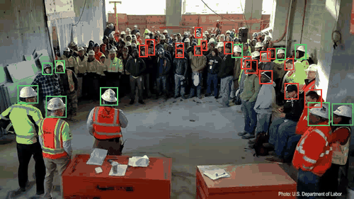
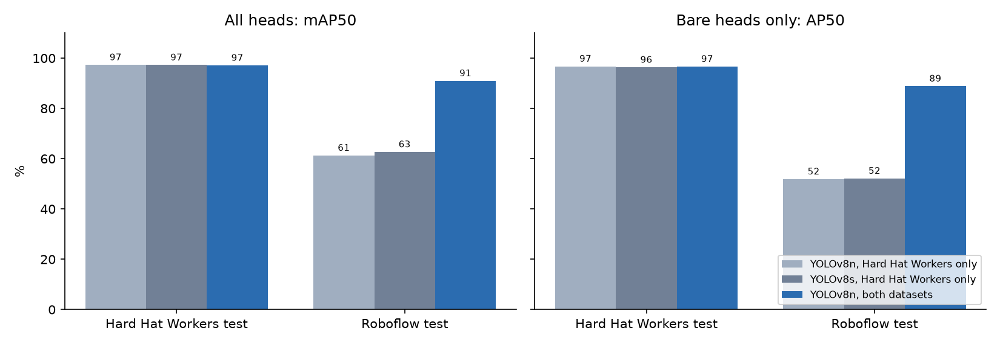
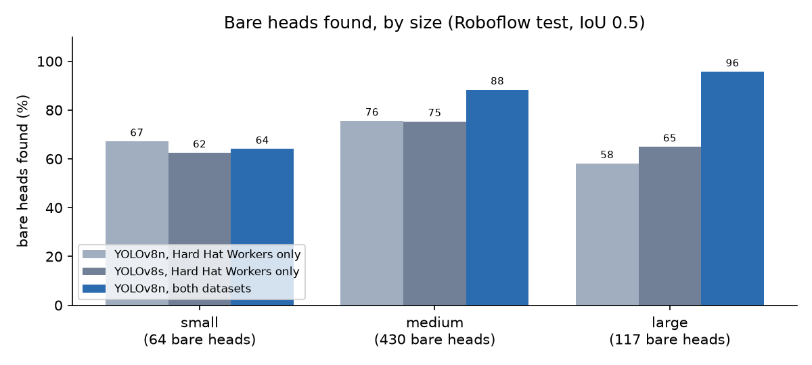
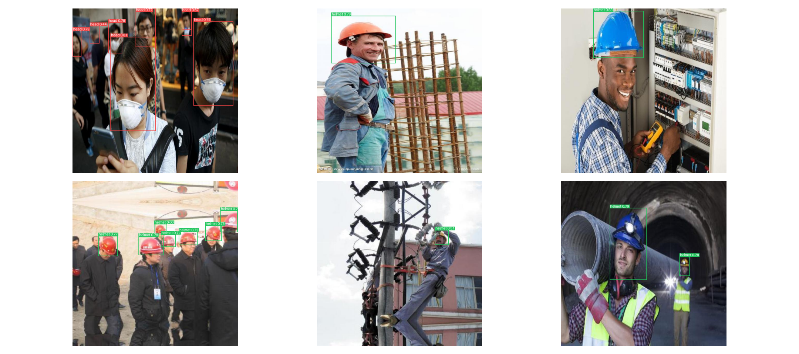
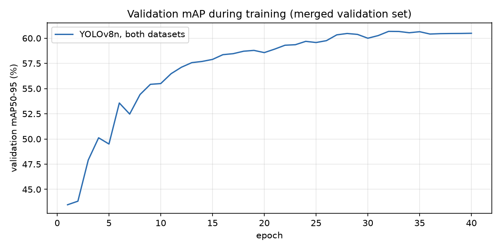

# Hard Hat Detection

[](https://github.com/Gauhet/hard-hat-detection/actions/workflows/tests.yml)

Finds people's heads in photos and video and marks each one as wearing a hard hat (green) or not
(red). It fine-tunes a COCO-pretrained YOLOv8n on two public datasets and reaches **97.1% mAP50**
on the standard Hard Hat Workers test set and **91.0%** on a second, more varied test set.



<sub>Footage: U.S. Department of Labor (OSHA), public domain, via Wikimedia Commons. The model never saw it during training.</sub>

## The problem a 97% score hid

The first version was trained only on Hard Hat Workers and scored 97% mAP50 on its test set. Then
a close-up photo of a woman with no hard hat came back labelled "helmet" with 0.68 confidence.

The training data explained it. Hard Hat Workers is mostly wide shots of construction sites. Its
close-ups are nearly all stock photos of workers wearing hard hats: of the training heads that
fill more than 15% of a photo, **175 wear hard hats and 3 are bare**. The model had learned that a big head
means a hard hat. The test set has the same skew (81 to 1), so the 97% score couldn't show it.

Two fixes:

1. **More varied data.** I added Roboflow's "Hard Hats" dataset, which includes close-ups,
   selfies and people in masks. After merging, the training set has 535 bare heads that fill more
   than 15% of the photo, instead of 3.
2. **One label per head.** The old YOLOv8s gave the same head two boxes, "head" at 0.68 and
   "helmet" at 0.61, because Ultralytics only suppresses overlapping boxes within a class.
   Prediction now suppresses overlaps across classes, so each head gets the single most
   confident label.

The same photo now comes back as "head" with 0.84 confidence.

## Results

| YOLOv8n | Hard Hat Workers test, mAP50 | Roboflow test, mAP50 | Bare heads, Roboflow test (AP50) | Large bare heads found |
|-|-|-|-|-|
| Trained on Hard Hat Workers only | 97.3% | 61.3% | 51.9% | 58% |
| **Trained on both datasets** | **97.1%** | **91.0%** | **88.8%** | **96%** |

<sub>Hard Hat Workers test: 1,766 photos, 6,666 heads. Roboflow test: 1,399 photos, 4,363 heads (Roboflow's test split minus copies of training photos, see below). Large: over 96×96 pixels, 117 bare heads in the Roboflow test set.</sub>



On the original benchmark the new model is within 0.2 points of the old one in mAP50 (0.5 in
mAP50-95: 66.5% against 67.0%). On the second test
set, where the old model had never seen photos like these, bare-head AP50 goes from 52% to 89%.



The improvement is concentrated in exactly the failure that started this: large bare heads go from
58% found to 96%. Small bare heads in the Roboflow test set are still hard (64%), but there are
only 64 of them, so that number is noisy.

There is a cost on the original test set. Small bare heads there are found 92.0% of the time,
down from 95.2%. The merged training data has proportionally fewer of the tiny, distant heads
that Hard Hat Workers is full of.

### As a safety alarm

A site doesn't need every box to be perfect. It needs to know whether anyone in view is missing a
hard hat. So each test photo is also scored as an alarm that should go off when the photo contains
at least one bare head.

| | Test set | Correct alarms | False alarms | Missed photos | Precision | Recall |
|-|-|-|-|-|-|-|
| Hard Hat Workers only | Hard Hat Workers | 315 | 49 | 24 | 86.5% | 92.9% |
| Both datasets | Hard Hat Workers | 305 | 35 | 34 | 89.7% | 90.0% |
| Hard Hat Workers only | Roboflow | 119 | 125 | 22 | 48.8% | 84.4% |
| Both datasets | Roboflow | 133 | 14 | 8 | 90.5% | 94.3% |

<sub>Confidence threshold 0.25, the Ultralytics default.</sub>

On the varied photos the old model's alarm was wrong more often than right (125 false alarms
against 119 correct ones). The new one raises 14 false alarms. On the original test set it trades
a few more missed photos for fewer false alarms. For a real site, where a missed bare head costs
more than a false alarm, I'd lower the threshold for the bare-head class.

### Model size

On the original data I also trained YOLOv8s (11.1M parameters against YOLOv8n's 3.1M). It scored
the same 97.3% mAP50 on the Hard Hat Workers test set, made the same close-up mistake (62.7% on
the Roboflow test set against YOLOv8n's 61.3%), and was 2.5× slower on a CPU (93 ms against 37 ms
per photo). So only YOLOv8n was retrained on the merged data. The fix came from the data, not
from model size.

### Sample test predictions



<sub>Random photos from the Roboflow test set: three close-ups, three wider shots. Note the two missed bare heads at the far left of the group photo.</sub>

## How it works

**Data** ([`data.py`](src/hardhat_detector/data.py)). Both datasets are downloaded, their COCO
boxes (left, top, width, height in pixels) clipped to the image and converted to YOLO's format,
and their labels mapped to two classes: `helmet` (a head with a hard hat) and `head` (a bare head).
Hard Hat Workers also labels a few hundred "person" boxes across 7,000 photos full of people. Labels
that incomplete would teach the model that most people are background, so they are dropped.

**Keeping the test sets clean** ([`dedupe.py`](src/hardhat_detector/dedupe.py)). Merging the
datasets naively would have leaked the test set: Roboflow's set already contains resized copies of
most Hard Hat Workers photos, including at least 1,446 of the 1,766 test photos, and about a
quarter of Roboflow's own test photos have near copies in its training split. So:

- Every photo gets a 64-bit difference hash (a 9×8 grey thumbnail, which ignores the stretching
  Roboflow applied). Photos within 10 bits of each other are grouped together.
- Roboflow photos cut from the same video (named like `IMG_1234_mp4-17`) are grouped together too.
- Each group goes to a single split. A group with an original test photo goes to test, so the
  Hard Hat Workers test set is exactly as published; a small group with a Roboflow test photo
  gives one photo to the Roboflow test set; everything else goes to training or validation. 6,914
  photos are dropped as copies.

After this, the closest training photo to any test photo is 11 bits away. Hashing can't catch
everything: some test photos are different shots from the same news story or photo shoot as a
training photo, which is also true of the original Hard Hat Workers split. The test numbers may be
slightly optimistic for that reason.

| Split | Photos | Heads |
|-|-|-|
| Train | 15,131 | 48,196 |
| Validation | 1,598 | 5,539 |
| Hard Hat Workers test | 1,766 | 6,666 |
| Roboflow test | 1,399 | 4,363 |

**Training** ([`train.py`](src/hardhat_detector/train.py)). YOLOv8n starts from COCO weights, so
it already knows what people look like, and is fine-tuned for 40 epochs at 640 px with the
Ultralytics defaults (AdamW, mosaic and colour augmentation). The epoch with the best validation
mAP50-95 (epoch 32) is kept. Training took 93 minutes on an RTX 4050 Laptop GPU.



**Evaluation** ([`evaluate.py`](src/hardhat_detector/evaluate.py),
[`metrics.py`](src/hardhat_detector/metrics.py)). mAP comes from Ultralytics. Recall by size and
the alarm metrics are computed separately, with the same prediction function the demo uses:
predictions are matched to ground-truth boxes greedily, most confident first, each claiming the
unmatched same-class box it overlaps most if the IoU is at least 0.5.

**Video** ([`predict.py`](src/hardhat_detector/predict.py)). Frames are read with OpenCV, run
through the detector one at a time, drawn on, and written back out, along with a count of how many
frames showed a bare head. YOLOv8n takes 6 ms per frame on the GPU and 37 ms on a CPU (Intel Core
Ultra 7 155H).

## Running it

Requires Python 3.10+. Install PyTorch for your hardware first
([pytorch.org](https://pytorch.org/get-started/locally/)), then the package:

```bash
git clone https://github.com/Gauhet/hard-hat-detection.git
cd hard-hat-detection
pip install -e ".[dev]"
```

Train. On the first run both datasets download (about 1.4 GB) and are converted, de-duplicated
and split, which takes a few minutes; the COCO weights download automatically.

```bash
python -m hardhat_detector.train --model yolov8n
```

Evaluate every trained model on both test sets and regenerate the figures in `assets/`:

```bash
python -m hardhat_detector.evaluate
```

Run the detector on your own photos or videos (annotated copies go to `predictions/`):

```bash
python -m hardhat_detector.predict site.jpg clip.mp4
```

Or try it in the browser: a Gradio app with a photo tab (upload or pull a random test photo) and
a video tab, and a choice of model and confidence threshold.

```bash
pip install -e ".[demo]"
python app.py   # then open http://localhost:7860
```

Run the tests:

```bash
pytest
```

## Project layout

```
src/hardhat_detector/
  data.py        downloads, COCO-to-YOLO conversion, de-duplicated splits
  dedupe.py      image hashing and near-duplicate grouping
  train.py       fine-tuning command
  metrics.py     box matching, recall by size, per-photo alarm metrics
  evaluate.py    test-set evaluation, model comparison and figures
  predict.py     detection on photos and videos
  draw.py        drawing boxes on images
app.py           browser demo (Gradio)
tests/           data, de-duplication, metrics and drawing checks
results/         training logs and test metrics for each model
assets/          figures and the demo GIF used in this README
```

## What I'd try next

- Train at a higher resolution (960 or 1280 px) to win back the small, distant heads.
- Choose a separate confidence threshold for bare heads from the validation set, aiming for a
  target alarm recall.
- Track heads across video frames (for example with ByteTrack) so the alarm counts people rather
  than frames, and doesn't flicker when a detection drops out for a frame.

## Data and credits

- **Hard Hat Workers**, public domain, via the [Hugging Face mirror](https://huggingface.co/datasets/hf-vision/hardhat).
- **Hard Hats** by Roboflow Universe Projects ([Roboflow Universe](https://universe.roboflow.com/roboflow-universe-projects/hard-hats-fhbh5)),
  licensed under [CC BY 4.0](https://creativecommons.org/licenses/by/4.0/), via the
  [Hugging Face mirror](https://huggingface.co/datasets/keremberke/hard-hat-detection). Its labels
  `hardhat` and `no-hardhat` are renamed `helmet` and `head`, and photos that duplicate the other
  dataset are removed.

I first used YOLOv8 in WorldQuant University's *Deep Learning for Computer Vision* lab. This
repository is my own implementation on public datasets, written from scratch; it contains no
course material.

## License

[AGPL-3.0](LICENSE), because the project is built on [Ultralytics](https://github.com/ultralytics/ultralytics),
which uses the same license.
